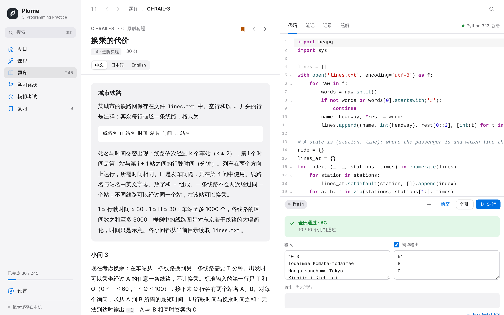
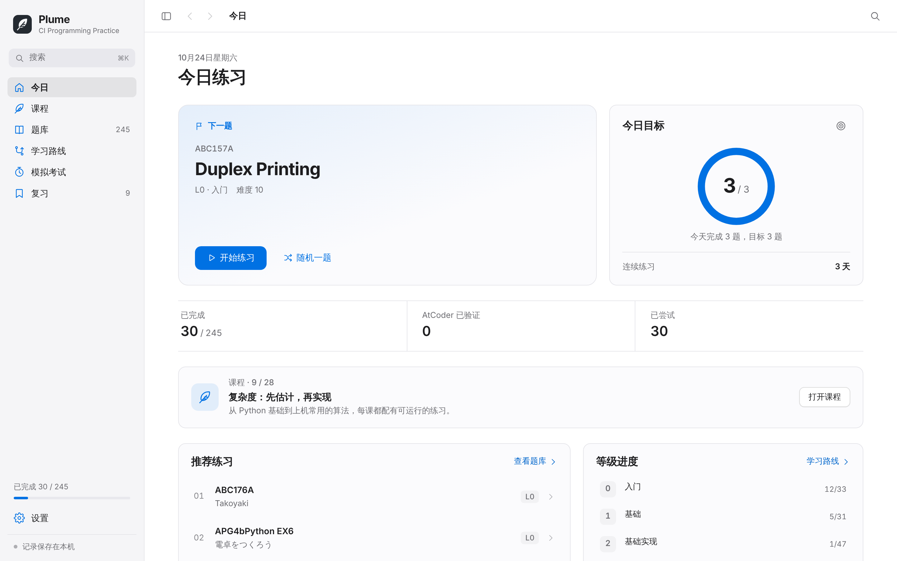
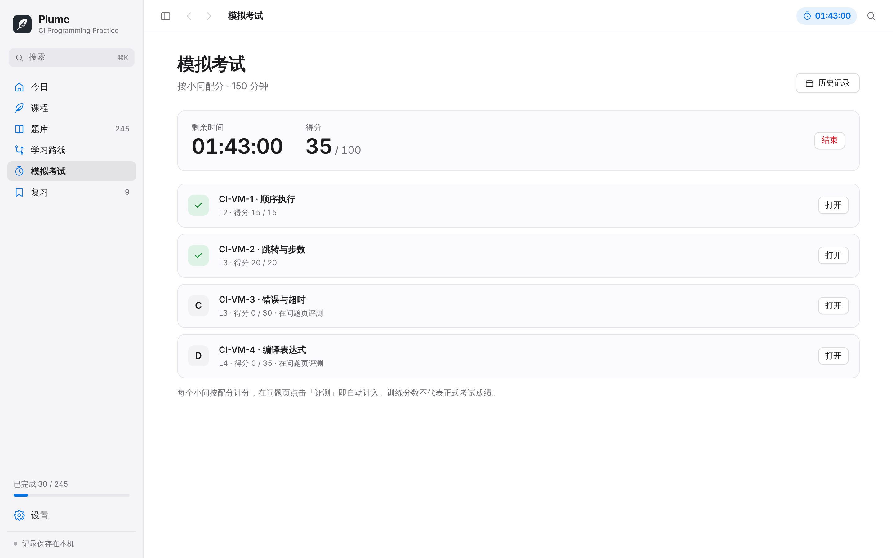
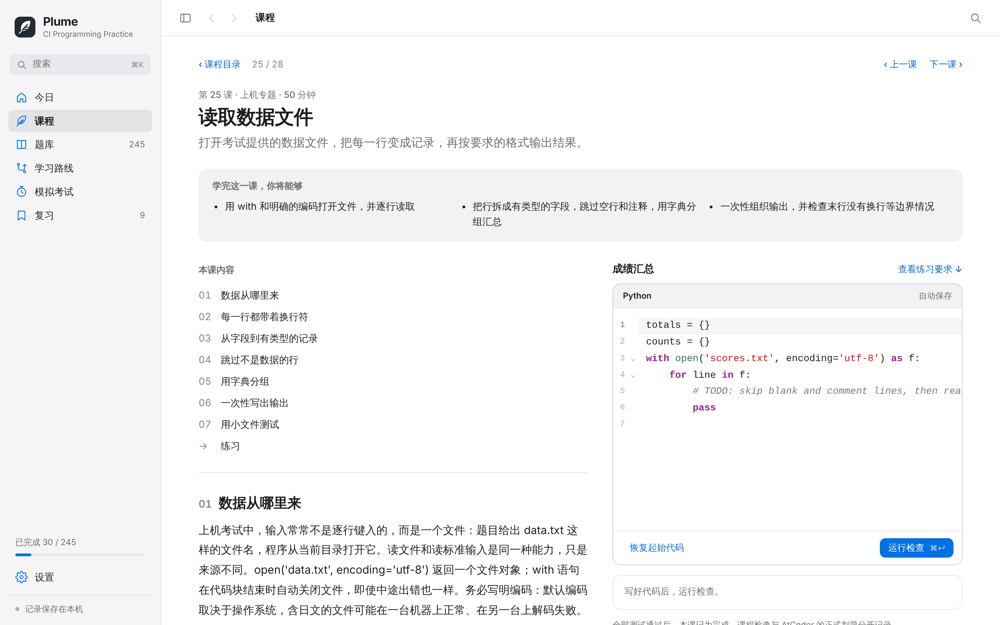
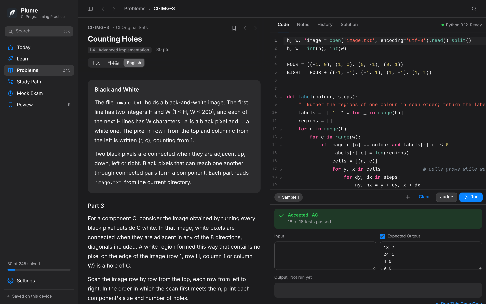

<p align="center">
  
</p>

<h1 align="center">Plume</h1>

<p align="center">
  为东京大学创造情报学（CI）上机考试准备的 Python 练习工作台<br>
  <sub>题库 · 课程 · 本地评测 · 限时模拟 · 中文 / 日本語 / English · 完全离线</sub>
</p>

<p align="center">
  <a href="#开始使用">开始使用</a> ·
  <a href="#题库">题库</a> ·
  <a href="#课程">课程</a> ·
  <a href="#评测与计分">评测与计分</a> ·
  <a href="#导入自己的题库">导入题库</a> ·
  <a href="#开发">开发</a>
</p>



## 特点

- **245 道题。** 221 道 AtCoder 题目按 L0–L5 分级，每题都有完整的中日英题面；另有 6 套 CI 风格原创套题，共 24 个小问。
- **贴近上机考试。** 原创套题与考试同构：一个情境、四个由浅入深的小问，多数套题附带数据文件，程序像在终端里一样用 `open()` 读取。
- **本地评测。** Python 3.12 在 WebAssembly 中运行，提供样例与隐藏用例、时间限制、浮点误差和特殊判题；代码不会离开本机。
- **28 节课程。** 从第一行 Python 讲到 BFS 与动态规划，再到读取数据文件、递归与记忆化、最短路、模拟与解析；每课都有可运行的示例和自动检查的练习。
- **限时模拟。** 按等级抽题，或把一整套原创题当作一场考试，按小问配分计时。
- **可扩展。** 用一个 JSON 文件导入自己的题目、数据文件和隐藏用例。
- **记录在本机。** 进度、代码、笔记、课程与模拟历史自动保存，可导出完整备份；也可以同步 AtCoder 的公开提交记录。

## 开始使用

### macOS App

GitHub Actions 会为每次推送构建 macOS 版本：在 [Actions](https://github.com/AquilaTvT/CIP/actions/workflows/check.yml) 中打开最近一次成功的运行，下载 `Plume-macOS`（需登录 GitHub），解压后把 `Plume.app` 拖入“应用程序”。也可以按[下文](#构建-macos-app)在本机构建。

App 自带题库、课程、编辑器和 Python 运行环境，不需要安装 Python 或打开浏览器，支持 macOS 13.3 及以上。构建使用本机临时签名，未经 Apple 公证；首次打开时若被拦截，请在“系统设置 → 隐私与安全性”中选择“仍要打开”。

### 浏览器（macOS / Windows / Linux）

安装 Python 3.9 或更高版本，在项目目录运行：

```sh
python3 start.py
```

浏览器会打开 `http://127.0.0.1:8765`。Windows 可以使用 `py start.py`；端口被占用时加上 `--port 8766`。服务只监听本机，题面、课程与 Python 运行环境全部来自本地文件。

## 界面

<table>
  <tr>
    <td width="50%"></td>
    <td width="50%"></td>
  </tr>
  <tr>
    <td width="50%"></td>
    <td width="50%"></td>
  </tr>
</table>

界面遵循 macOS 的设计习惯：侧栏导航、分段控件、浅色与深色外观、减少动态效果，以及完整的键盘操作。三种界面语言与三种题面语言可以分别设置。

## 题库

### AtCoder 分级题

| 等级 | 名称 | 题数 |
| :---: | --- | ---: |
| L0 | 入门 | 33 |
| L1 | 基础 | 31 |
| L2 | 基础实现 | 47 |
| L3 | CI 核心 | 45 |
| L4 | 进阶实现 | 40 |
| L5 | 综合算法 | 25 |

等级是学习路线，与 ABC 的题目字母不一一对应；L0 按先修关系从 `PracticeA` 开始。每题的中文、日文、英文题面分别保存在本地（共 663 份），包含全部约束、输入输出格式、官方样例与图示；所选语言的题面总是完整显示，不会悄悄换成另一种语言。配点与 Difficulty 取自 AtCoder 与 AtCoder Problems。

### CI 原创套题

| 套题 | 情境 | 考查内容 | 时间 |
| --- | --- | --- | ---: |
| 访问日志分析 | 解析 Web 服务器日志 | 文件读取、字典计数、排序、会话切分、滑动窗口 | 120 分钟 |
| 游程编码 | 压缩与还原字符串 | 字符串处理、前缀和与二分、区间动态规划 | 120 分钟 |
| 栈式计算机 | 解释并编译一门小语言 | 模拟、标签与跳转、错误与超时、递归下降 | 150 分钟 |
| 仓库机器人 | 网格地图上的搬运 | 邻接判断、BFS、状态压缩 DP、字典序 Dijkstra | 120 分钟 |
| 城市铁路 | 换乘与时刻表 | Dijkstra、状态扩展、依赖时刻的最短路 | 150 分钟 |
| 黑白图像 | 像素与连通性 | 洪水填充、4/8 连通与洞、单调栈求最大矩形 | 120 分钟 |

每套 4 个小问、共 100 分，题面、讲解与参考解答均有中日英三语。隐藏用例由固定种子生成，每个用例都用独立的暴力解法核对过参考答案。

## 课程

| 章 | 内容 |
| --- | --- |
| 开始编程 | 第一个程序、输入与整数、条件分支、循环与累计 |
| 组织数据与程序 | 字符串、列表与下标、嵌套循环与二维表、函数 |
| 分析与验证 | 调试、复杂度估算、无遗漏的穷举、排序 |
| 序列与查询 | 集合与字典、前缀和、二分搜索、双指针 |
| 图与搜索 | 栈与队列、BFS、DFS 与连通分量、网格搜索 |
| 状态、策略与综合 | 动态规划、0/1 背包、贪心与交换论证、完整解题流程 |
| 上机专题 | 读取数据文件、递归与记忆化、优先队列与最短路、模拟与解析 |

每课包含学习目标、逐步推演、带输入输出的代码示例、常见错误、自测问答、一道原创练习与详细解答，并链接到题库中的后续练习。练习的全部用例通过后记为完成；课程进度与题目记录分开保存。详见[课程说明](docs/ACADEMY.md)与[学习顺序](docs/CURRICULUM.md)。

## 评测与计分

**运行**依次执行控制台中的全部用例，包括样例和自己添加的用例；**评测**执行全部样例与隐藏用例，结果为 AC、WA、RE、TLE 或 OLE，并记入该题的历史。每次运行都在新的 Python 解释器中进行，每个用例拥有独立的模块、标准流和工作目录。答案不唯一或允许误差的题目使用相应的判定规则。

本地结果只代表本机用例上的表现，**不等于官方 AC**。填写 AtCoder 用户名后，可以同步公开的提交记录，官方结果会标为“已验证”。

模拟考试在开始时固定题目、时长、计分方式与账号：

- **每题 100 分** 或 **原题配点**：最终通过的题目，首次通过前的每次错误加罚 5 分钟；CE 与 IE 不计罚时。
- **按小问配分**：以一整套原创题为一场考试，每个小问按其分值计分。

模拟分数是训练指标，不是东京大学考试的成绩，也不能预测考试成绩。

## 导入自己的题库

在“设置 → 题库”中可以下载模板、导入题库包、导出任意题库包。题库包是一个 JSON 文件：

```json
{
  "format": "plume-pack",
  "version": 1,
  "id": "my-practice",
  "title": "My Practice",
  "problems": [
    {
      "id": "MY-1",
      "title": "Sum",
      "statement": "Read two integers and print their sum.",
      "samples": [{"input": "1 2\n", "output": "3\n"}],
      "tests": [{"input": "-5 5\n", "output": "0\n"}]
    }
  ]
}
```

题目可以分组成套、附带数据文件、指定时间限制与判定方式，并提供参考解答。导入时会完整校验，题面经过与内置题面相同的安全过滤。内置的 [CI 原创套题](data/packs/ci-original.json) 本身就是一个完整示例，字段说明见 [题库包格式](docs/PROBLEM_PACKS.md)。

## 数据与隐私

- **浏览器**：记录保存在当前浏览器、当前地址与端口的本地存储中，并请求浏览器不要在空间不足时清理。
- **macOS App**：每次保存都在磁盘上确认写入 `~/Library/Application Support/org.cipractice.desktop/state.json`。
- **备份**：在“设置 → 数据与备份”导出 JSON，内容包括代码、笔记、记录、课程进度、模拟历史与已导入的题库包。导入备份会替换当前记录，不会合并。

无需注册，代码与备份不会上传。只有 AtCoder 同步和更新题目数据时会访问公开服务。浏览器与 App、不同浏览器之间的记录彼此独立，迁移时请使用备份。

## 快捷键

| 快捷键 | 操作 |
| --- | --- |
| `⌘K` / `Ctrl+K` | 按题号、标题或题面内容搜索题目 |
| `⌘↵` / `Ctrl+Enter` | 运行当前用例或课程检查 |
| `⇧⌘↵` / `Ctrl+Shift+Enter` | 评测全部用例 |
| `⌘F` / `Ctrl+F` | 在编辑器中查找 |
| `⌘,` / `Ctrl+,` | 打开设置 |

## 开发

运行本身不需要安装 npm 依赖；编辑器、MathJax 与 Python 运行环境已随仓库提供。开发检查使用 Python 3.12 与 Node.js 22：

```sh
npm ci --ignore-scripts
python3 scripts/assemble_library.py
python3 scripts/assemble_academy.py --check
python3 scripts/build_packs.py --check
python3 -m unittest discover -s tests -p '*_test.py'
node --test tests/*.test.cjs
npm run check
```

```text
index.html · app.js · styles.css   界面、题库、工作区、评测、模拟与本地存储
library.js                         题库包：校验、存储、Markdown、输出判定
academy.js · settings.js           课程与设置、使用指南
pyworker.js · vendor/              Python（Pyodide）、编辑器与 MathJax
data/                              题面、元数据、课程与原创套题的发布文件
packs/ci-original/                 原创套题的源文件：题面、参考解、暴力解与用例生成器
packaging/                         macOS App 外壳与本地存储桥
scripts/ · tests/                  构建、打包与测试
```

题面、课程与原创套题都由源文件生成，修改后运行对应的脚本即可；详见 [架构说明](docs/ARCHITECTURE.md)、[验证方式](docs/VALIDATION.md) 与 [参与贡献](CONTRIBUTING.md)。

### 构建 macOS App

在安装了 Xcode Command Line Tools 的 Mac 上运行：

```sh
python3 scripts/build_app.py              # 当前架构；加 --universal 构建双架构
python3 scripts/package_release.py
```

输出 `dist/Plume.app`、`release/Plume-source.zip`、对应架构的 `Plume-macOS-*.zip` 与 SHA-256 校验文件。打包脚本会核对题库、课程、原创套题与最新的界面文件，不会收集本机的练习记录。

## 许可

Plume 的代码与原创套题采用 [MIT 许可证](LICENSE)。AtCoder 题目、图示与元数据，以及 Pyodide、MathJax、CodeMirror 等第三方组件保留各自的权利与许可，详见 [THIRD_PARTY_NOTICES.md](THIRD_PARTY_NOTICES.md)。

<p align="center"><sub>由 Aquila 设计与开发</sub></p>
